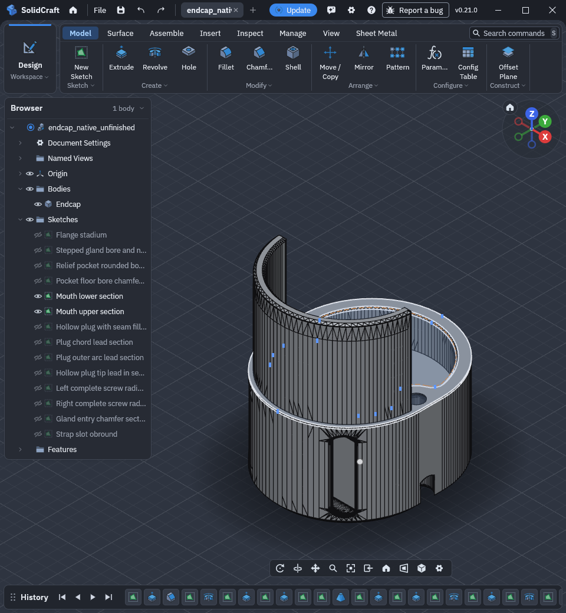
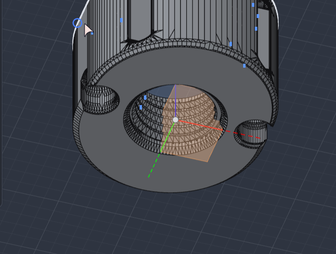
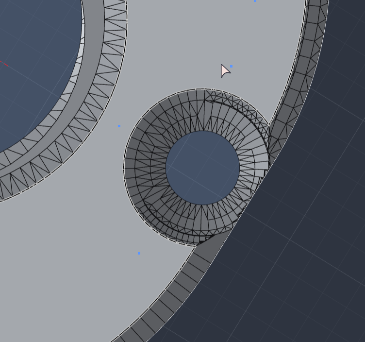

# Direct STL export creates degenerate facets and nonmanifold thread-seam topology (0.21.0)

**Status:** upstream issue draft only; not submitted.

## Environment

- SolidCraft CLI **0.21.0**
- Linux **x86_64**
- Model units: millimetres
- Evidence checker: Python 3, standard library only; no SolidCraft, OCCT, or source-project installation required to inspect the attached STL files.

## Summary

Direct STL export of the attached saved SolidCraft design contains degenerate facets and fails printable-shell topology validation. The saved native document is a valid hybrid design (native features plus persisted imported geometry); it is a legitimate exporter input, not a request to reconstruct an external source project. Opening/exporting this document does not require that source project.

The original direct STL has **23,851 triangles**, including **60 facets with repeated vertices**. A source-only import/export control also has 60 such facets, so the observation is not confined to the hybrid feature history. Independent tessellation of STEP exported from the saved native design produces a closed, consistently outward-oriented, edge- and vertex-manifold STL without mesh healing.

The affected regions were identified during the original investigation as microscopic thread-face seams. This identifies the observed location, not a proven root cause in the exporter.

For downstream work, the raw export cannot pass the retained printable-shell checker even though the saved design can be exported to STEP and tessellated successfully. This interrupts the direct SolidCraft-to-STL printing workflow and requires an external tessellation step; the controls establish a usable workaround, not that the direct exporter has been repaired.

## Expected behaviour

Exporting a valid single-solid design to STL should produce a nondegenerate, connected, closed, consistently oriented edge- and vertex-manifold surface suitable for printing. In particular, adjacent tessellated faces should agree at their shared seams.

## Actual behaviour and measured evidence

The attached read-only checker compares vertices by **exact stored coordinates**; it does not weld, round, repair, or regenerate geometry.

| Attached STL | Triangles | Repeated-vertex facets | Checker result |
| --- | ---: | ---: | --- |
| `evidence/native_export_original.stl` | 23,851 | 60 | Rejects: `Mesh has a degenerate facet` |
| `evidence/source_only_roundtrip.stl` | 22,921 | 60 | Rejects: `Mesh has a degenerate facet` |
| `evidence/source_fine.stl` | 44,166 | 0 | Passes: one closed edge- and vertex-manifold shell, outward winding |
| `evidence/native_step_occt_control.stl` | 46,524 | 0 | Passes: one closed edge- and vertex-manifold shell, outward winding |

Full checker outputs, commands and exit codes are in `evidence/validation_results.json`. These were obtained solely by inspecting the existing attached meshes; no CAD/export crash or modelling operation was rerun while preparing this issue.

Earlier investigation also reported non-edge-manifold topology after tighter coordinate welding, and pinch/nonmanifold vertices after a more permissive weld. The retained early metrics at **0.0002 mm** welding reported 23,506 triangles, incidence-two edges, one connected component and coherent orientation. **Those criteria were incomplete:** a later vertex-manifold check rejected that repair with `Mesh has a nonmanifold vertex`. Consequently, `evidence/historical_incomplete_weld_metrics.json` is included as a historical diagnostic, **not** evidence of a valid repair. Exact tighter-weld settings/counts and a pinched-vertex coordinate list were not retained in this bundle; no new values are asserted here.

The successful control is **fresh OCCT tessellation of STEP exported from the saved native document, without welding or mesh healing**, not the rejected microscopic-weld experiment. Its measured mesh volume is 7,208.03368366944 mm³. The source-fine control has a different tessellation (volume 7,207.052877404052 mm³); it is context, not an exact-byte or exact-volume expectation for the native exporter.

## Minimal reproduction using the attached document

Run from this issue directory after unpacking the entire bundle. SolidCraft CLI must already be installed:

```sh
solidcraft-cli run --in evidence/endcap_hybrid_baseline.solidcraft \
  --out reproduced.stl
python3 evidence/validate_stl.py reproduced.stl
```

Expected: checker exit code 0. Observed on the preserved original export: exit code 1 with the degenerate-facet error above. The exact new-export triangle count may depend on tessellation settings; the commands are provided for upstream reproduction and were not rerun during issue preparation.

To inspect the preserved failure and controls without running CAD:

```sh
# Expected exit code 1:
python3 evidence/validate_stl.py evidence/native_export_original.stl
python3 evidence/validate_stl.py evidence/source_only_roundtrip.stl
# Expected exit code 0:
python3 evidence/validate_stl.py evidence/source_fine.stl
python3 evidence/validate_stl.py evidence/native_step_occt_control.stl
```

For comparison, export the same saved document as STEP:

```sh
solidcraft-cli run --in evidence/endcap_hybrid_baseline.solidcraft \
  --out reproduced.step
```

`evidence/native_persisted.step` preserves the previously exported STEP. The successful control was generated from that saved-native STEP using OCCT through build123d 0.10.0 (`export_stl` linear tolerance 0.005 mm, angular tolerance 0.1 radians). That external tessellation step is provenance/workaround information; the bundled Python checker does not perform it or require its dependencies.

## Supplemental visual and editable context — not the STL reproducer

The shared [current unfinished native-only design](../shared/endcap_native_unfinished.solidcraft) is a **later reconstruction**, not `evidence/endcap_hybrid_baseline.solidcraft`. It is included so maintainers can inspect the current editable endcap and understand the physical regions involved across the related reports. **No direct STL export/topology validation of this later native-only model is claimed.** Use the original hybrid baseline and preserved raw STL above for this issue's validated failure.



*Current native-only model in the GUI, with its feature tree. The visible faceting provides overall modelling context; viewport lines do not prove mesh holes, degenerate triangles or nonmanifold topology.*



*User-provided underside overview locating the two screw-access recesses. This is orientation context for the endcap and the related fillet report, not a localization of the STL defects.*



*User-provided closeup of one recess where the cut exits the outside flank. The intended seam fillet is absent in the current unfinished model. This view is not evidence that this visible edge is an exporter defect or the site of the retained mesh failures.*

The saved supplemental model contains **32 native timeline features, 14 sketches and one body**, ending with #29 `Strap mouth fabric fillets`, #30 `Plug tip corner fillets`, #31 `Modeled M12.3x1.5 gland thread`, and #32 `Sew native threaded topology`. It does **not** contain the final screw-breakout seam fillets. Opening it may rebuild the native history, including the expensive thread; the screenshot is not a promise of instant opening or evidence of a cached rebuild. Neither these images nor the later model replace the maintained checker's recorded evidence for the original raw STL defects.

## Scope and caveats

- The native input is self-contained and ready for the exporter reproduction above. It is the full-featured saved endcap, **not yet a feature-minimized model**.
- Native validity and healthy-history observations were established in the original investigation. `evidence/native_validity_observations.log` retains the relevant recorded valid-single-solid parameter probes; the checker only assesses STL topology, not B-rep validity.
- The source-only roundtrip STL is a preserved contextual control, not a separate fully bundled source-only CAD reproduction. The external source project is neither included nor required for the primary native-document reproduction.
- The checker stops at the first topology failure; it does not enumerate every defect, prove absence of self-intersections, or localize faulty thread faces. “Pass” means its explicitly documented topology/orientation checks passed.
- No claim is made that welding repairs the original STL. The demonstrated workaround is STEP retessellation with no mesh healing.
- No exporter root cause or fixed tessellation tolerance is claimed. Exact OS distribution/kernel and exporter-internal tessellation settings were not preserved with these artifacts.

## Attachments

Attach the **complete per-issue ZIP**, preserving this issue directory and its sibling `shared/` directory when extracting. The relative image/model links then resolve locally. For a pasted GitHub issue body, upload the screenshots as issue attachments as well; local relative links alone are not hosted GitHub images. Do not substitute the later shared model for the original reproducer in the commands above.

### Primary reproducer, failing export and controls (`evidence/`)

All filenames below are relative to `evidence/`:

- `endcap_hybrid_baseline.solidcraft`: unchanged saved hybrid native input, preserved before ongoing native-only reconstruction; **primary CAD reproducer**.
- `native_export_original.stl`: original failing native direct export.
- `source_only_roundtrip.stl`: contextual SolidCraft source-only import/export control.
- `source_fine.stl`: valid fine source tessellation control.
- `native_persisted.step`: STEP previously exported from the persisted native design.
- `native_step_occt_control.stl`: valid no-healing OCCT retessellation of that STEP.
- `validate_stl.py`: standalone stdlib-only read-only validation CLI, reusing the project's retained validator with a small JSON-reporting wrapper.
- `validation_results.json`: exercised checker outputs and exit codes for all four attached meshes.
- `recorded_final_mesh_metrics.json`: retained original final-control validation metrics.
- `historical_incomplete_weld_metrics.json` and `historical_weld_failure.log`: diagnostic evidence of the insufficient weld attempt and subsequent rejection; not a valid output recommendation.
- `native_validity_observations.log`: retained original native parameter-probe observations.
- `manifest.json`: attachment sizes and SHA-256 hashes (excluding the manifest itself).

### Supplemental current native context (`../shared/`)

- [endcap_native_unfinished.solidcraft](../shared/endcap_native_unfinished.solidcraft): saved later native-only editable design, with the 32-feature history described above; **not validated as an STL reproducer**.
- [native-endcap-overview.png](../shared/native-endcap-overview.png): loaded GUI model and tree.
- [screw-access-underside.png](../shared/screw-access-underside.png): user underside overview of both recesses.
- [screw-breakout-detail.png](../shared/screw-breakout-detail.png): user closeup of the unfinished screw-breakout seam.

The issue-root `SHA256SUMS` covers every evidence file, including the manifest.
From this issue directory, verify attachment integrity with `sha256sum -c SHA256SUMS`.
